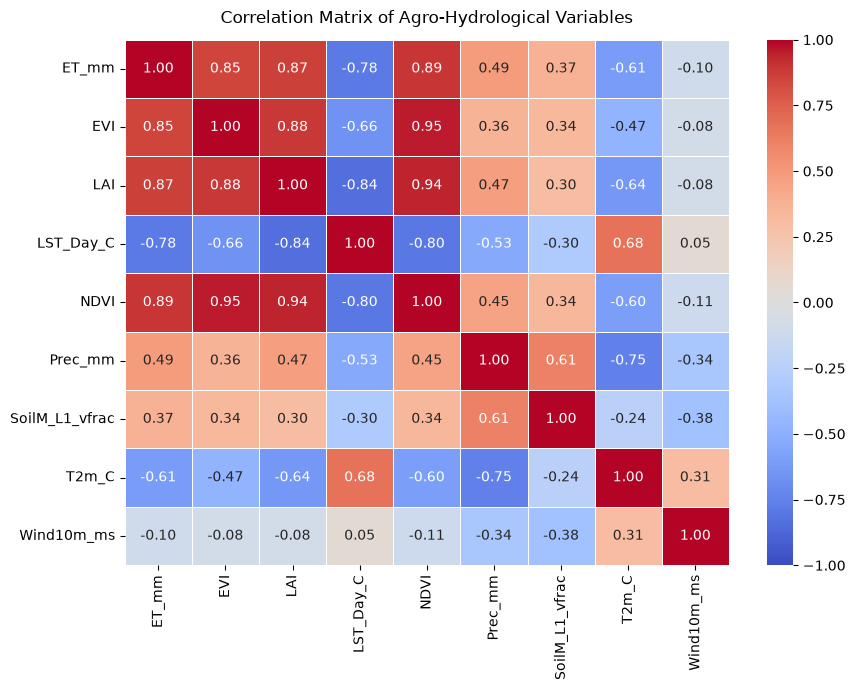
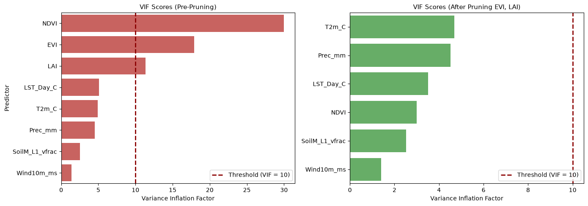
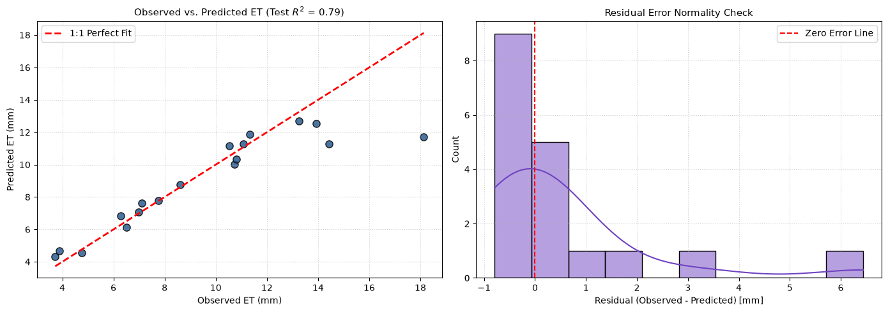
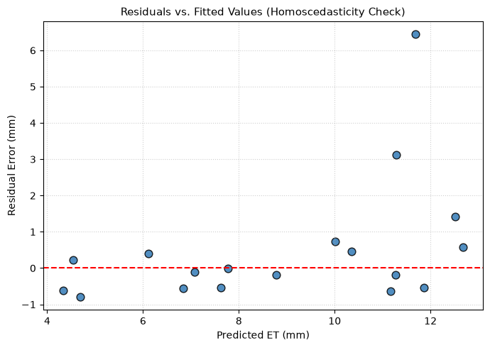

# Applied Machine Learning Assignment 1 – Predicting Evapotranspiration over Islamabad: Report

| | |
|---|---|
| **Name** | Sohail Zulfiqar |
| **Registration ID** | 578135 |
| **Email** | szulfiqar.ms25igis@student.nust.edu.pk |
| **Program** | MS GIS & RS – 2025 |
| **Subject** | Applied Machine Learning (Dr Hammad Gilani) |
| **Repository** | https://github.com/sohailzulfiqarrao/aml-ms25igis-578135 (folder `Assignments/Assignment 1`) |
| **Live page** | https://sohailzulfiqarrao.github.io/aml-ms25igis-578135/Assignments/Assignment%201/ |
| **Notebook** | [`Islamabd_MLR_Assignment.ipynb`](Islamabd_MLR_Assignment.ipynb), data in [`Islamabad_Data.csv`](Islamabad_Data.csv) |

## 1. Objective and data

The aim is to predict surface evapotranspiration (`ET_mm`) across the Islamabad Capital Territory from satellite-derived vegetation indices and climate variables, using multiple linear regression. `Islamabad_Data.csv` has **87 observations** and eight candidate predictors:

| Variable | Meaning |
|---|---|
| `NDVI`, `EVI` | Normalized Difference and Enhanced Vegetation Indices |
| `LAI` | Leaf Area Index |
| `LST_Day_C` | Daytime land surface temperature, °C |
| `T2m_C` | Air temperature at 2 m, °C |
| `Prec_mm` | Precipitation, mm |
| `SoilM_L1_vfrac` | Soil moisture, layer 1, volume fraction |
| `Wind10m_ms` | Wind speed at 10 m, m/s |

## 2. Method

1. **Completeness audit.** All 87 rows are complete: 0 nulls and no sentinel values.
2. **Outliers.** IQR fences (Q1 − 1.5 IQR, Q3 + 1.5 IQR) flag LAI (10 values), wind (5), daytime LST (2), precipitation (1) and 2 m temperature (1). Each value is capped at its fence, so no row is dropped.
3. **Correlation and VIF.** NDVI, EVI and LAI are strongly correlated with each other (EVI–NDVI r = 0.95). EVI has a VIF of 17.90 and is removed first, by judgment: NDVI correlates more strongly with ET (0.89 against 0.85), whereas dropping the highest VIF would have discarded NDVI (29.98). NDVI then falls to 9.17, but LAI stays at 11.06, so a loop removes it too. It stops when every VIF is below 10; all six remaining predictors are below 5 (maximum 4.69).
4. **Split and scaling.** An 80/20 split with seed 42 gives 69 training rows and 18 test rows. The six remaining predictors are z-score scaled with a scaler fitted on the training rows only.
5. **Fit and evaluate.** Ordinary least squares, scored on both partitions and with 5-fold shuffled cross-validation (seed 42).
6. **Inference.** The model is refitted with statsmodels on the 69 training rows for coefficients, p-values and residual tests.

## 3. Results

### Train and test scores

| Partition | MAE | MSE | RMSE | R² | Adj. R² | MAPE % |
|---|---|---|---|---|---|---|
| Training (69 rows) | 1.0055 | 2.2437 | 1.4979 | 0.8147 | 0.7968 | 10.98 |
| **Testing (18 rows)** | 0.9730 | 3.1604 | 1.7778 | **0.7853** | 0.6682 | 9.05 |

### 5-fold cross-validation

| Fold | R² | RMSE (mm) |
|---|---|---|
| 1 | 0.7853 | 1.7778 |
| 2 | 0.5992 | 1.9265 |
| 3 | 0.7009 | 1.9470 |
| 4 | 0.8528 | 1.5144 |
| 5 | 0.6833 | 1.6812 |
| **Mean (± std)** | **0.7243 (±0.0873)** | **1.7694 (±0.1607)** |

### Fitted equation

```
ET_mm = 12.6693 - 0.1104(LST_Day_C) + 16.7041(NDVI) - 0.0012(Prec_mm)
        + 14.3144(SoilM_L1_vfrac) - 0.9457(T2m_C) + 6.7737(Wind10m_ms)
```

| Predictor | Coefficient | Standardized β | p-value | VIF |
|---|---|---|---|---|
| **NDVI** | 16.7041 | 2.4311 | < 0.001 | 2.99 |
| **SoilM_L1_vfrac** | 14.3144 | 0.6694 | 0.032 | 2.52 |
| T2m_C | -0.9457 | -0.6038 | 0.151 | 4.69 |
| Wind10m_ms | 6.7737 | 0.2131 | 0.332 | 1.40 |
| Prec_mm | -0.0012 | -0.1811 | 0.654 | 4.52 |
| LST_Day_C | -0.1104 | -0.1593 | 0.690 | 3.50 |

NDVI is by far the strongest predictor: its standardized β of 2.43 is more than three times the next largest in size. Only NDVI and soil moisture are significant at the 5% level.

## 4. Figures

### Correlation matrix


NDVI, EVI and LAI correlate with ET at 0.89, 0.85 and 0.87, and with each other at 0.88 to 0.95. This is the collinearity the VIF step addresses.

### Variance inflation factors


Removing EVI brings NDVI under the threshold of 10 (30.0 to 9.2), but LAI stays just above it (11.3 to 11.1), so it is removed as well. In the right panel all six remaining predictors are below 5.

### Observed against predicted, and residual distribution


Most of the 18 test points sit close to the 1:1 line: 15 residuals are within ±1 mm. The highest observed values (about 14 mm and above) are predicted too low, which gives the long right tail in the residual histogram.

### Residuals against fitted values


For predicted values below 11 mm the residuals stay within about ±0.8 mm. Above that the spread widens and the largest residuals appear, including one of about 6.4 mm and one of about 3.1 mm.

## 5. Diagnostics and limits

- **Collinearity is resolved.** After pruning EVI and then LAI, every VIF is below 5 (largest: `T2m_C` at 4.69). Only NDVI and soil moisture are significant at the 5% level; the other four coefficients cannot be distinguished from zero.
- **Residuals are not normal.** In the statsmodels fit on the training rows the Jarque–Bera test gives p = 0.0035 and the omnibus test p = 0.023. The Durbin–Watson statistic is 2.10 (no sign of autocorrelation) and the condition number is 5.74. Equal variance was judged from the residual plot only; no formal test was run.
- **The test set is small.** With 18 rows the test R² of 0.785 sits within a fold range of 0.60 to 0.85. Fold 1 reproduces the test-set scores exactly (R² 0.7853, RMSE 1.7778 mm), so the cross-validated mean of 0.724 is the steadier figure.
- **Outliers were capped, not removed.** Capping keeps all 87 rows but changes the flagged predictor values, mainly LAI and wind.

## 6. Files and how to run

| File | What it is |
|---|---|
| `Islamabd_MLR_Assignment.ipynb` | The notebook: audit, capping, iterative VIF pruning, scaling, regression and cross-validation |
| `Islamabad_Data.csv` | Its input data |
| `index.html`, `images/` | The results page and the four figures taken from the notebook |

The notebook reads `Islamabad_Data.csv` from its working folder. Run it from this folder with Jupyter, or open it in [Google Colab](https://colab.research.google.com/github/sohailzulfiqarrao/aml-ms25igis-578135/blob/main/Assignments/Assignment%201/Islamabd_MLR_Assignment.ipynb) and upload the CSV first:

```
pip install notebook pandas scikit-learn matplotlib seaborn statsmodels tabulate
jupyter notebook
```

When run, the notebook also writes four figures and five CSV tables (audit, metrics, coefficients, VIF and test predictions) next to itself; they are not committed here.
