# Applied Machine Learning Assignment 2 – Clustering E-commerce Product Offers: Report

*K-means, Agglomerative, DBSCAN and Gaussian Mixture Models: implementation, diagnostics and a deployment decision.*

| | |
|---|---|
| **Name** | Sohail Zulfiqar |
| **Registration ID** | 578135 |
| **Email** | szulfiqar.ms25igis@student.nust.edu.pk |
| **Program** | MS GIS & RS – 2025 |
| **Subject** | Applied Machine Learning (Dr Hammad Gilani) |
| **Date** | 26 October 2026 |
| **Repository** | https://github.com/sohailzulfiqarrao/aml-ms25igis-578135 (folder `Assignments/Assignment 2`) |
| **Live page** | https://sohailzulfiqarrao.github.io/aml-ms25igis-578135/Assignments/Assignment%202/ |
| **Code** | [`Clustering_Assignment.ipynb`](Clustering_Assignment.ipynb) (notebook), [HTML export with code](https://sohailzulfiqarrao.github.io/aml-ms25igis-578135/Assignments/Assignment%202/Clustering_Assignment.html) |
| **Data** | [`pricerunner_aggregate.csv`](pricerunner_aggregate.csv) (PriceRunner product offers) |
| **PDF** | [Full report](https://sohailzulfiqarrao.github.io/aml-ms25igis-578135/Assignments/Assignment%202/Clustering_Report.pdf), [one-page summary](https://sohailzulfiqarrao.github.io/aml-ms25igis-578135/Assignments/Assignment%202/Clustering_Summary_1page.pdf) |

# 1. Executive Summary

**What was done.** Four clustering algorithms (K-means, Ward agglomerative clustering, DBSCAN, Gaussian mixtures) were implemented on **35,311 PriceRunner product offers** (free-text titles from 306 merchants, 10 product categories). Titles were turned into a 20-dimensional, unit-length latent-semantic (LSA) vector. All tuning used a 10,000-offer *dev* split; the remaining **25,311 offers were kept unseen** for a final generalisation test. Category labels were used only to *evaluate* clusters, never to fit them.

| Model | Clusters | Noise | ARI (dev) | NMI (dev) | ARI (unseen) | NMI (unseen) | Stability (ARI) | Native `predict()` |
|---|---|---|---|---|---|---|---|---|
| **K-means** | 10 | 0 % | **0.62** | **0.70** | **0.62** | **0.70** | **0.82** | yes |
| Agglomerative (Ward) | 10 | 0 % | 0.55 | 0.68 | 0.56 | 0.69 | 0.68 | no |
| DBSCAN (eps 0.475, min_samples 160) | 15 | 19.5 % | 0.47 | 0.64 | 0.48 | 0.65 | 0.74 | no |
| GMM (full covariance) | 10 | 0 % | 0.54 | 0.65 | 0.53 | 0.65 | 0.69 | yes |

*ARI/NMI: agreement with the 10 true categories (1 = perfect, 0 = chance). Stability: ARI between refits on 80 % subsamples. "Unseen" = 25,311 offers never used for fitting or tuning; Ward and DBSCAN are scored there with a nearest-neighbour rule because they have no native `predict()`.*

**Answers in one line each** (derivations and evidence in the question sections):

1. **Why K-means fails:** it minimises squared distance to centroids, i.e. it assumes equal-size, equal-spread, spherical, convex clusters. Closed-form tipping points (size ratio $\approx 25$, elongation $\sqrt{\pi/8}\approx 0.63$) were confirmed by simulation: K-means collapses (ARI $\approx 0$) where GMM or DBSCAN score 1.0.
2. **Standardisation:** with four unscaled title descriptors added, one feature carried 93 % of the variance and K-means clusters became bins of title length (ARI **0.01**, 97 % of title-length variance explained). Z-scoring restored ARI to **0.54**. Standardising features that were already on a common scale gave no reliable gain.
3. **DBSCAN parameters:** `min_samples` and `eps` jointly fix one density level. Use the dimension rule ($\ge D+1$, typically $2D$ or more) for a range of `min_samples`, read the k-distance knee as an **upper bound** for `eps` (here it merged $\ge$ 94 % of points into one cluster), then choose the cell of a (`min_samples`, `eps`) grid that maximises a **label-free** score. This selected `min_samples` = 160, `eps` = 0.475, the same cell an oracle using labels would pick.
4. **Deployment:** **K-means** (k = 10, on L2-normalised LSA). It is the most accurate (ARI 0.62 on 25,311 unseen offers), the most stable under resampling, tens of times cheaper to fit than Ward (and the gap grows with $n$), and the only simple model with an exact out-of-sample rule. A confidence margin routes uncertain offers to review.

# 2. Problem, Data and Protocol

**Business problem.** A price-comparison engine receives merchant offers whose titles are free text (e.g. *"apple iphone 8 plus 64gb silver"*). Grouping offers into coherent families (phones, washing machines, CPUs, ...) supports catalogue clean-up, category-level price analytics and routing to the right product-matching model. New merchants arrive without labels, which is why unsupervised clustering is attractive.

**Data.** `pricerunner_aggregate.csv` (the data file in the assignment folder; it opens directly in Excel): 35,311 offers with `Product Title`, `Merchant ID`, a fine ground-truth product id (`Cluster ID`, 13,233 products) and a coarse `Category Label` (10 categories). The ten categories are the evaluation target.

**Protocol (no leakage).**

- **Split:** a stratified 10,000-offer **dev** set for every fitting and tuning step; the other **25,311 offers are only touched in Section 9** to test generalisation.
- **Fit on dev only:** TF-IDF vocabulary and the SVD are learned on dev titles, then applied to the unseen offers.
- **Labels are for scoring, not fitting.** Hyper-parameters come from label-free criteria (BIC, silhouette, k-distance, dendrogram). Two disclosed exceptions: $k = 10$ is taken from the retailer's 10-category taxonomy, and the embedding size (20) was checked against labels (Figure 3).
- **Metrics.** *Internal:* silhouette, Davies-Bouldin, Calinski-Harabasz. *External* (against category): Adjusted Rand Index (ARI, chance-corrected pair agreement, 0 = random, 1 = identical), Normalised Mutual Information (NMI), homogeneity (each cluster holds one category), completeness (each category sits in one cluster), purity. DBSCAN noise is counted as its own group for external scores and excluded from internal scores.

**Where the four questions are answered:** Q1 (Section 6), Q2 (Section 7), Q3 (Section 8, using the DBSCAN experiments of Section 4.3), Q4 (Section 9).

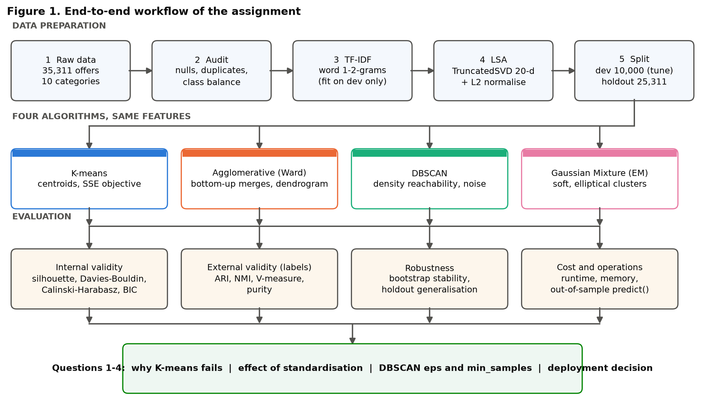

## 2.1 Data audit

**Findings.**

- **Clean and complete:** no missing values; the CSV header had stray leading spaces (`" Merchant ID"`), stripped on load.
- **Duplicates are real.** 4,318 offers (12.2 %) repeat another title exactly: the same product listed by several merchants. They are kept (they are genuine marketplace density) but they matter for DBSCAN, where identical points count towards `min_samples`.
- **Class imbalance 2.5 : 1** (5,501 fridge-freezers vs 2,212 freezers), relevant to Q1.
- **Short, noisy text:** median 52 characters (about 8 words); 40.6 % of products have a single offer; some titles are German (*geschirrspüler*, *einbau*, *kühlschrank*), which will matter later.

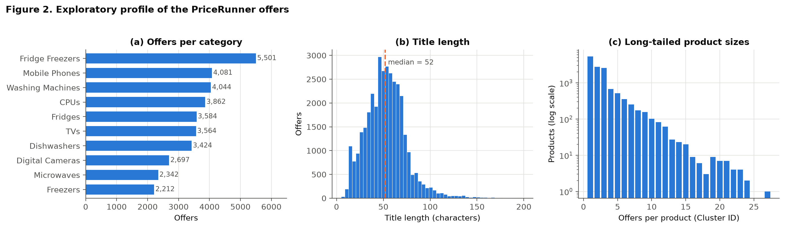

# 3. Feature Engineering and the Number of Clusters

## 3.1 From titles to a geometry

1. **TF-IDF** on word 1- and 2-grams (`min_df = 3`, sublinear term frequency): $w_{t,d} = \big(1+\ln \mathrm{tf}_{t,d}\big)\cdot\Big(\ln\tfrac{1+N}{1+\mathrm{df}_t}+1\Big)$, then each title is scaled to unit length.
2. **Latent semantic analysis (LSA):** truncated SVD $X \approx U_k\Sigma_k V_k^{\top}$ keeps $k$ dense latent coordinates $Z = XV_k$. Raw TF-IDF is 6,083-dimensional and 99.8 % zeros, where Euclidean distances concentrate and clustering is poor.
3. **Row normalisation** $\hat z_i = z_i/\lVert z_i\rVert$, so that $\lVert\hat z_i-\hat z_j\rVert^2 = 2\,(1-\cos\theta_{ij})$. Euclidean K-means on $\hat z$ is therefore cosine (spherical) K-means, and DBSCAN's `eps` is a cosine-type distance ($\varepsilon = 0.475 \Rightarrow \cos\theta \ge 0.887$).

**How many latent dimensions?** Figure 3 shows K-means quality rising to a plateau (NMI $\approx 0.70$-$0.72$) from 20 dimensions upward, and Ward peaking at 20 (0.68) then declining. **20 dimensions** is the smallest size on the plateau (16.1 % of TF-IDF variance, which is normal for sparse text). This is the one place labels were consulted.

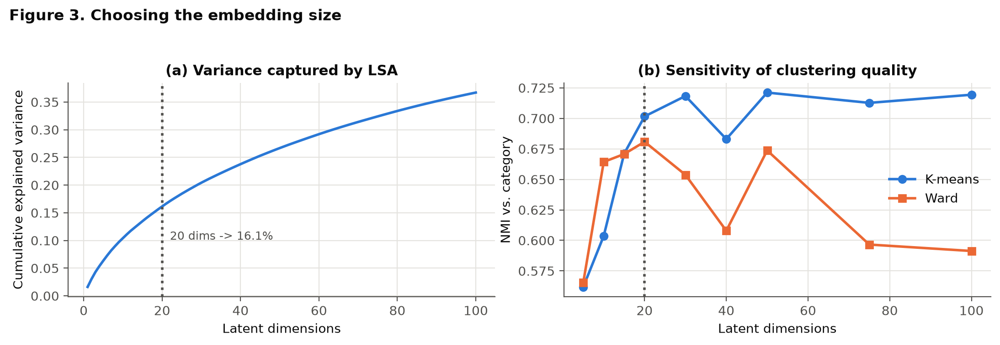

## 3.2 How many clusters?

No internal index points at $k = 10$: inertia falls smoothly, while silhouette, Calinski-Harabasz and Davies-Bouldin keep improving and are best at **$k = 19$** (Figure 4). The reason is structural: every category contains many brand/model families, so finer partitions always look "tighter". External NMI is flat at about 0.67-0.72 for $k = 9$-$14$. We therefore fix **$k = 10$ from the business taxonomy** (and say so), rather than pretend the data select it. The same $k$ is used for K-means, Ward and GMM; DBSCAN chooses its own number of clusters.

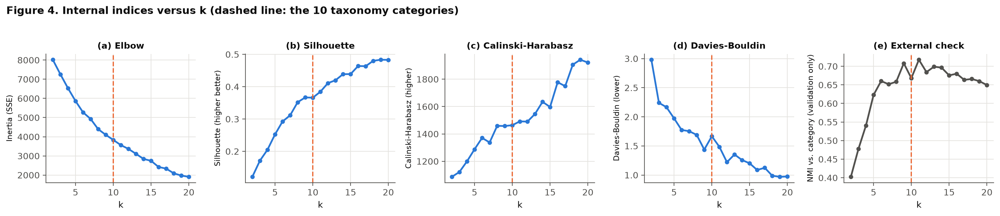

# 4. The Four Algorithms

## 4.1 K-means

**Objective.** Find centroids $\mu_1..\mu_K$ minimising the within-cluster sum of squares $J=\sum_{k}\sum_{x\in C_k}\lVert x-\mu_k\rVert^2$. **Lloyd's algorithm** alternates *assign* (each point to its nearest centroid) and *update* ($\mu_k \leftarrow$ mean of $C_k$); $J$ never increases, so it converges, but only to a **local** minimum, hence k-means++ seeding and many restarts. Cost per run is $O(n\,K\,D\,I)$ time and $O(nD)$ memory.

The notebook contains a from-scratch implementation. Started from the same centroids, it reaches **exactly** the same partition as scikit-learn (ARI = 1.0000, identical inertia). Using 20 restarts, scikit-learn then finds a slightly better optimum (inertia 3,810 vs 3,840), a reminder that K-means results depend on initialisation.

**Table. K-means clusters (dev set):** size, majority category, purity and the highest-weight TF-IDF terms.

| Cluster | Size | Majority category | Purity | Top terms |
| :--- | ---: | :--- | ---: | :--- |
| 0 | 1372 | Fridge Freezers | 81% | freezer, fridge freezer, fridge, frost, frost free, free |
| 4 | 1224 | Dishwashers | 54% | bosch, dishwasher, washer, integrated, dryer, washer dryer |
| 1 | 1123 | Mobile Phones | 94% | sim, phone, mobile, mobile phone, samsung, sim free |
| 8 | 1105 | Fridges | 50% | liebherr, fridge, white, freezer, larder, under |
| 3 | 1096 | CPUs | 99% | intel, processor, core, ghz, xeon, intel xeon |
| 2 | 967 | TVs | 97% | tv, led, hd, smart, 4k, led tv |
| 6 | 876 | Digital Cameras | 86% | camera, digital, canon, sony, black, body |
| 7 | 868 | Dishwashers | 30% | siemens, ler, geschirrsp ler, geschirrsp, einbau, gorenje |
| 5 | 740 | Washing Machines | 100% | washing, machine, washing machine, white, spin, machine white |
| 9 | 629 | Microwaves | 84% | microwave, oven, microwave oven, steel, stainless steel, stainless |

**Reading the clusters.** Seven of ten clusters are at least 80 % pure (CPUs 99 %, washing machines 99.9 %, TVs 97 %, mobile phones 94 %, cameras 86 %, microwaves 84 %, fridge-freezers 81 %). Three are mixed. Cluster 7 is not a category at all: **72 % of its offers contain German marker words** (vs 0-3 % in the other clusters) so K-means has grouped by *language*, a nuisance direction in the embedding. Clusters 4 (dishwashers 54 %, washing machines 26 %) and 8 (fridges 50 %, freezers 30 %) mix neighbouring appliance types whose titles share vocabulary.

## 4.2 Agglomerative hierarchical clustering (Ward)

Every offer starts as its own cluster; the two closest clusters are merged repeatedly. **Ward linkage** merges the pair with the smallest increase in within-cluster variance,
$$\Delta(A,B)=\frac{n_A\,n_B}{n_A+n_B}\,\lVert\mu_A-\mu_B\rVert^2,$$
the same sum-of-squares criterion as K-means, so its clusters are compact. Exact agglomeration needs the full pairwise-distance matrix: **$O(n^2)$ memory and $\ge O(n^2)$ time**, the main limitation (Section 9).

**Linkage comparison** (3,000-offer subsample). *Single* linkage chains almost everything into one cluster (96.8 % of offers, ARI 0.003); *complete* linkage is poor (ARI 0.27); *Ward* and *average* are close (ARI 0.52 vs 0.54, NMI 0.67 vs 0.68; differences of this size are within sampling noise). **Ward** is used because it optimises the same criterion as K-means and has the clean $\Delta$ interpretation above. The dendrogram (Figure 5) shows no sharp gap in merge cost at $k=10$: the cut is again imposed by the taxonomy.

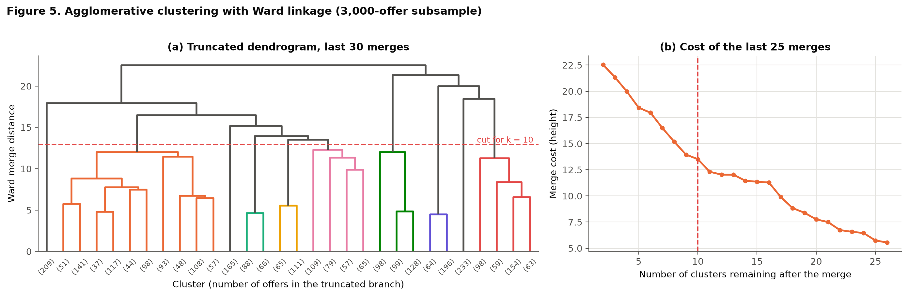

**Table. Ward clusters (dev set):** size, majority category, purity and top terms.

| Cluster | Size | Majority category | Purity | Top terms |
| :--- | ---: | :--- | ---: | :--- |
| 3 | 1907 | Fridge Freezers | 60% | freezer, fridge, fridge freezer, liebherr, frost, smeg |
| 0 | 1781 | Fridges | 26% | bosch, white, fridge, hotpoint, in, washer |
| 1 | 1158 | Mobile Phones | 92% | sim, phone, samsung, mobile, mobile phone, black |
| 2 | 1082 | CPUs | 99% | intel, processor, core, ghz, xeon, intel xeon |
| 7 | 955 | TVs | 97% | tv, hd, led, smart, 4k, led tv |
| 9 | 871 | Digital Cameras | 86% | camera, digital, canon, sony, body, digital camera |
| 5 | 736 | Washing Machines | 100% | washing, machine, washing machine, white, spin, machine white |
| 8 | 541 | Dishwashers | 96% | dishwasher, integrated dishwasher, integrated, place, fully, fully integrated |
| 6 | 493 | Fridge Freezers | 35% | siemens, gorenje, einbau, hl, eek, hl gefrier |
| 4 | 476 | Microwaves | 98% | microwave, oven, microwave oven, steel, in, built in |

**Reading the clusters.** Ward isolates CPUs (99 %), washing machines (99.9 %), TVs (97 %), microwaves (98 %), dishwashers (96 %) and mobile phones (92 %) well, but it puts 1,781 offers in a mixed "bosch, white, hotpoint, washer" cluster (26 % fridges) and, like K-means, creates a German-language cluster (cluster 6, 36 % fridge-freezers).

## 4.3 DBSCAN and principled parameter selection

**Definitions.** For radius $\varepsilon$ and threshold $m$ (`min_samples`, counting the point itself): a point is a **core point** if $|N_\varepsilon(p)|\ge m$; a point is a **border point** if it is within $\varepsilon$ of a core point but is not core; clusters are the connected components of core points plus their border points; all remaining points are **noise** ($-1$). DBSCAN needs no $k$, finds arbitrarily shaped clusters, and labels outliers.

**The selection procedure (no labels, no guessing)**

1. **Range for `min_samples`** from the dimension rule $m \ge D+1$ (here $D = 20$), the common default being $m = 2D$ (Sander et al., 1998); larger values for noisy, duplicated data. We scan $m \in \{5,\dots,320\}$.
2. **Upper bound for `eps`** from the **k-distance curve**: sort every point's distance to its $m$-th neighbour and take the knee (farthest point below the chord, Kneedle style).
3. **Scan below the knee** with a (`min_samples` $\times$ `eps`) grid and score every cell *without labels*: $\;\text{score}=(1-\text{noise fraction})\times\text{silhouette of the clustered points}\;$, subject to a **percolation guard** (at least 2 clusters and no cluster holding more than 50 % of the data). The score rewards tight clusters *and* coverage; without the noise factor, silhouette alone would reward discarding almost everything.
4. **Check the plateau and stability**, and only then compare with labels.

Results: (a) the knee **overshoots** (Figure 6 and the table: from `min_samples` = 40 upward, the knee `eps` merges at least 94 % of the clustered points into one cluster); (b) the grid optimum is **interior** (score 0.401, 0.441, 0.446, **0.451** at `min_samples` 40, 80, 120, **160**, then falls to 0.348 at 240), with a plateau over 80-160; (c) the selected cell is `min_samples` = 160, `eps` = 0.475.

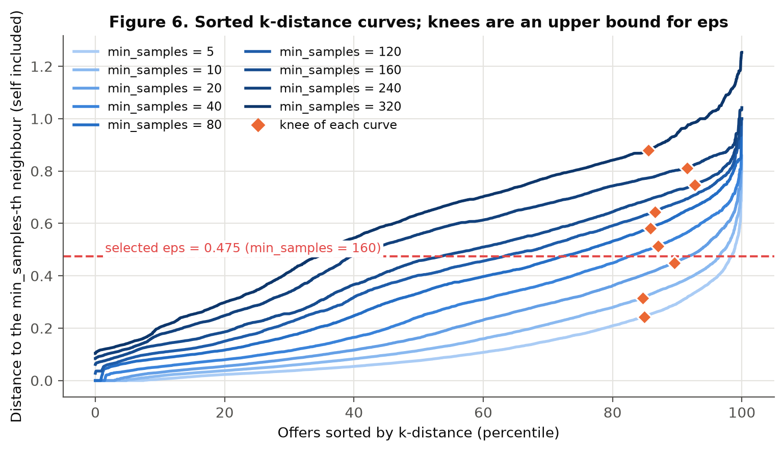

**Table. What the k-distance knee suggests, and what it does.** The knee `eps` is an upper bound: for `min_samples` of 40 or more it merges at least 94 % of the clustered points into one cluster.

| min_samples | eps (knee) | Clusters | Noise | Largest cluster | ARI |
| :--- | ---: | ---: | ---: | ---: | ---: |
| 5 | 0.244 | 143 | 11.7% | 27.1% | 0.335 |
| 10 | 0.315 | 48 | 9.3% | 28.5% | 0.366 |
| 20 | 0.448 | 6 | 3.5% | 72.6% | 0.109 |
| 40 | 0.513 | 2 | 2.9% | 94.5% | 0.003 |
| 80 | 0.582 | 2 | 1.8% | 95.4% | 0.003 |
| 120 | 0.644 | 1 | 0.8% | 99.2% | 0.000 |
| 160 | 0.747 | 1 | 0.1% | 99.9% | -0.000 |
| 240 | 0.811 | 1 | 0.1% | 99.9% | -0.000 |
| 320 | 0.879 | 1 | 0.1% | 99.9% | -0.000 |

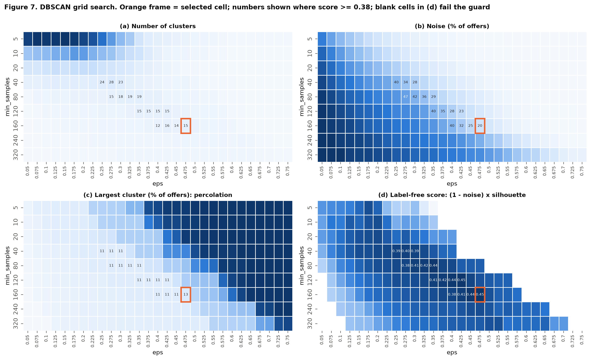

**Table. Best cell for each `min_samples` (label-free score; ARI shown for reference only).**

| min_samples | eps | Clusters | Noise | Largest cluster | Silhouette | Score | ARI (reference) |
| :--- | ---: | ---: | ---: | ---: | ---: | ---: | ---: |
| 5 | 0.175 | 203 | 21.3% | 10.7% | 0.436 | 0.343 | 0.330 |
| 10 | 0.200 | 102 | 25.5% | 10.7% | 0.469 | 0.349 | 0.319 |
| 20 | 0.200 | 47 | 37.2% | 10.7% | 0.573 | 0.360 | 0.255 |
| 40 | 0.275 | 28 | 33.9% | 10.8% | 0.607 | 0.401 | 0.299 |
| 80 | 0.350 | 19 | 29.1% | 10.8% | 0.623 | 0.441 | 0.367 |
| 120 | 0.425 | 15 | 23.2% | 10.9% | 0.581 | 0.446 | 0.432 |
| 160 | 0.475 | 15 | 19.5% | 13.1% | 0.560 | 0.451 | 0.469 |
| 240 | 0.475 | 9 | 42.5% | 10.9% | 0.605 | 0.348 | 0.310 |
| 320 | 0.525 | 7 | 45.0% | 10.9% | 0.609 | 0.335 | 0.295 |

**Table. DBSCAN clusters (dev set, the 12 largest of 15):** size, majority category, purity and top terms.

| Cluster | Size | Majority category | Purity | Top terms |
| :--- | ---: | :--- | ---: | :--- |
| 6 | 1310 | Fridge Freezers | 63% | freezer, fridge, fridge freezer, frost, frost free, free |
| 5 | 1091 | CPUs | 99% | intel, processor, core, ghz, xeon, intel xeon |
| 3 | 959 | TVs | 97% | tv, hd, led, smart, 4k, led tv |
| 0 | 881 | Digital Cameras | 85% | camera, digital, black, sony, canon, body |
| 4 | 704 | Mobile Phones | 99% | sim, smartphone, sim free, free, dual, unlocked |
| 2 | 669 | Washing Machines | 100% | washing, machine, washing machine, white, machine white, spin |
| 1 | 453 | Fridge Freezers | 36% | siemens, gorenje, einbau, hl, eek, hlschrank |
| 10 | 415 | Microwaves | 98% | microwave, oven, microwave oven, steel, in, stainless |
| 8 | 282 | Dishwashers | 100% | dishwasher, integrated dishwasher, integrated, fully integrated, fully, place |
| 12 | 260 | Mobile Phones | 100% | phone, mobile, mobile phone, nokia, htc, sim |
| 9 | 241 | Fridge Freezers | 24% | bosch, hlschrank, wei, edelstahl, bosch hlschrank, hlger |
| 11 | 233 | Washing Machines | 100% | washer, dryer, washer dryer, dryer white, white, 5kg |

**Reading the clusters.** DBSCAN returns 15 dense groups that cover 80.5 % of the offers and flags 19.5 % as noise. Its clusters are very pure where it commits (CPUs 99 %, TVs 97 %, washing machines 100 %, mobile phones 99-100 %, dishwashers 98-100 %, microwaves 98 %) but it does not split the fridge / fridge-freezer / freezer region and creates German-language clusters. Homogeneity ("Homog." in the table) is high (0.68) but completeness ("Compl.") lower (0.62): **DBSCAN is a precise but partial clustering**. **HDBSCAN**, which removes `eps` altogether, produced 92 micro-clusters and 41.9 % noise on this data (ARI 0.07), so it does not rescue the category task either.

## 4.4 Gaussian mixture model (EM)

**Model.** $p(x)=\sum_{k=1}^{K}\pi_k\,\mathcal N(x\mid\mu_k,\Sigma_k)$. **EM** alternates the E-step (responsibilities $r_{ik}=\pi_k\mathcal N(x_i\mid\mu_k,\Sigma_k)\big/\sum_j\pi_j\mathcal N(x_i\mid\mu_j,\Sigma_j)$) and the M-step ($\pi_k,\mu_k,\Sigma_k$ re-estimated with weights $r_{ik}$); the log-likelihood never decreases. The covariance structure is chosen with the **BIC** $=p\ln n-2\ln\hat L$ (lower is better). K-means is the limit $\Sigma_k=\sigma^2 I$, $\pi_k = 1/K$, $\sigma\to 0$.

**Selection.** At $k = 10$ the BIC is lowest for **full** covariance ($-648{,}954$) against diagonal ($-405{,}529$), spherical ($-262{,}086$) and tied ($-257{,}245$), and falls further as $k$ grows (Figure 8), the same "finer is always better" pattern as the internal indices. The fitted mixture is confident: 97.7 % of offers have a posterior $\ge 0.99$ and only 1.0 % are ambiguous ($<0.9$) (Figure 9).

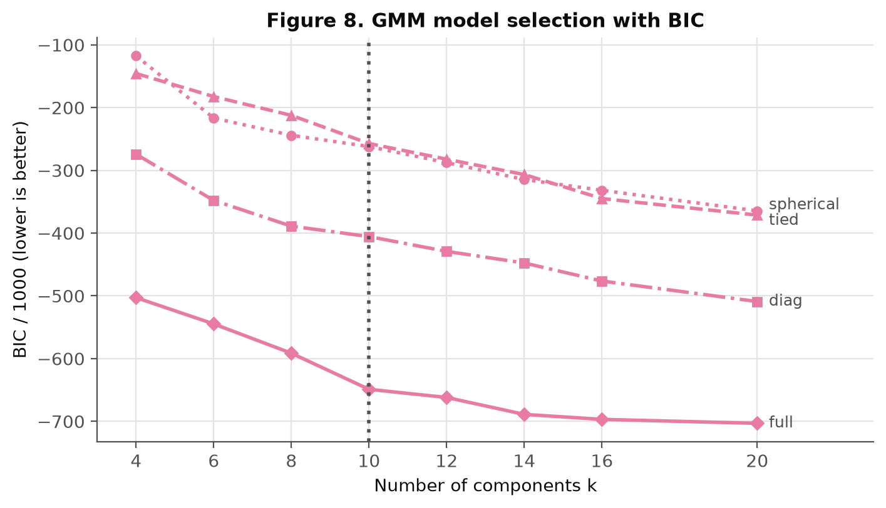

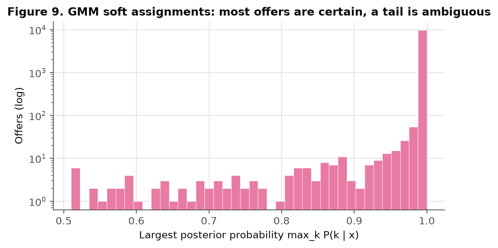

# 5. Model Comparison

**Table. Dev set (10,000 offers), 10 true categories.** DBSCAN's internal indices are computed on the 80.5 % of offers that were not labelled as noise.

| Model | Clusters | Noise | Fit (s) | Silh. | Davies-Bouldin | Calinski-Harabasz | ARI | NMI | Homog. | Compl. | Purity |
| :--- | ---: | ---: | ---: | ---: | ---: | ---: | ---: | ---: | ---: | ---: | ---: |
| K-means | 10 | 0.0% | 0.3 | 0.372 | 1.57 | 1480 | 0.622 | 0.699 | 0.700 | 0.697 | 0.769 |
| Agglomerative (Ward) | 10 | 0.0% | 5.5 | 0.357 | 1.68 | 1346 | 0.550 | 0.681 | 0.669 | 0.693 | 0.731 |
| DBSCAN | 15 | 19.5% | 0.2 | 0.558 | 0.84 | 2066 | 0.469 | 0.644 | 0.677 | 0.615 | 0.714 |
| GMM | 10 | 0.0% | 22.2 | 0.289 | 2.28 | 1057 | 0.538 | 0.654 | 0.653 | 0.655 | 0.688 |

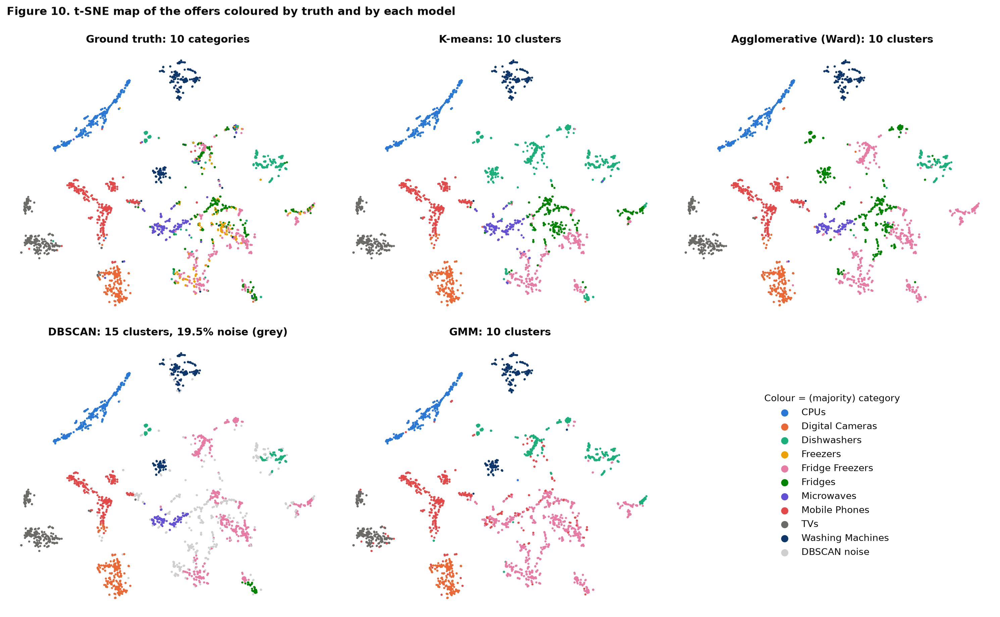

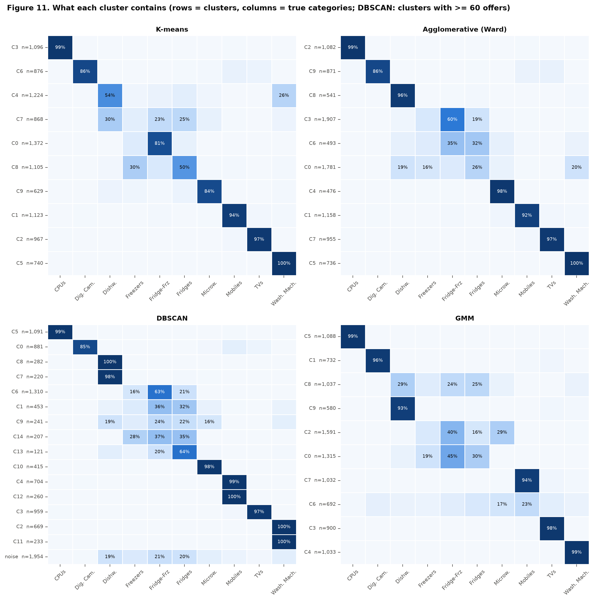

**Reading the table.**

- **External agreement ranks K-means > Ward > GMM > DBSCAN** (ARI 0.62 / 0.55 / 0.54 / 0.47; NMI 0.70 / 0.68 / 0.65 / 0.64).
- **DBSCAN's silhouette (0.56) and Davies-Bouldin (0.84) look best only because they are computed on the 80.5 % of offers that were not discarded**; they are not comparable with the other rows.
- All four models recover the visually separate "islands" (CPUs, TVs, cameras, phones, washing machines; Figure 10). They differ in the crowded middle of the map where fridges, freezers, dishwashers and microwaves overlap (Figure 11). GMM's two largest clusters (1,591 and 1,315 offers) each blend fridge-freezers with fridges, freezers or microwaves, whereas K-means and Ward keep these better apart.
- Every model creates at least one **German-language cluster**: language is a stronger signal in the embedding than category for those offers (see Section 10).

# 6. Question 1: Why can K-means fail when clusters differ in density, size or shape?

> **Short answer.** K-means minimises $J=\sum_k\sum_{x\in C_k}\lVert x-\mu_k\rVert^2$. This is the hard-assignment limit of a Gaussian mixture with **identical isotropic covariances $\sigma^2 I$ and equal weights**. It can therefore only represent equal-spread, roughly equal-size, *convex, spherical* clusters. When the data violate these assumptions, the partition that minimises $J$ is **not** the partition a human would call correct.

**Mathematics: four failure modes.**

1. **Density / spread: the boundary ignores variance.** A point goes to the nearer centroid, so the boundary is the perpendicular bisector halfway between centroids, **whatever the spreads**. For two clusters $N(0,\sigma_1^2)$ and $N(d,\sigma_2^2)$ with $\sigma_1\gg\sigma_2$, the fraction of the broad cluster lost to the tight one is (first order) $\;1-\Phi\!\big(\tfrac{d}{2\sigma_1}\big)$, e.g. 20 % when $\sigma_1 = 0.6\,d$. A density-aware (Bayes) boundary would sit much closer to the tight cluster.
2. **Size: splitting a big cluster is cheaper than isolating a small one.** Separating cluster $B$ from $A$ lowers $J$ by $\dfrac{n_An_B}{n_A+n_B}\lVert\mu_A-\mu_B\rVert^2\approx n_B\,d^2$ (the Ward identity of Section 4.2). Cutting a Gaussian cluster of $n_1$ points through its centre lowers $J$ by $\tfrac{2}{\pi}n_1\sigma_1^2$. K-means prefers to **split the large cluster and swallow the small one** when
$$\frac{n_1}{n_2}>\frac{\pi}{2}\,\frac{d^2}{\sigma_1^2}\quad(=25\ \text{for clusters } d=4\sigma_1\text{ apart, i.e. clearly separated}).$$

3. **Shape: elongation.** Two thin parallel stripes (long-axis std $\sigma_a$, gap $d$) with $n$ points in total: the correct split lowers $J$ by $nd^2/4$, a wrong cut across the long axis by $\tfrac{2}{\pi}n\sigma_a^2$. The wrong cut wins when $\;\sigma_a/d>\sqrt{\pi/8}\approx0.63$. Euclidean distance has no notion of direction, so correlated/elongated clusters are cut across.
4. **Non-convexity.** Voronoi cells are convex, so interleaved shapes (two moons, concentric rings, a river, a fault line) cannot be separated by *any* choice of centroids.

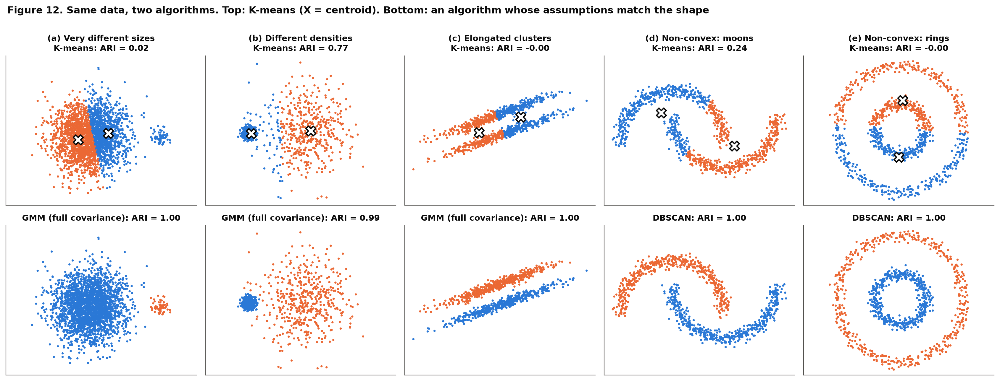

*Figure 12 note: GMM was fitted with 10 random starts (`init_params="random_from_data"`) and the best likelihood kept; initialising it from K-means would inherit K-means' wrong partition, which is itself a practical lesson.*

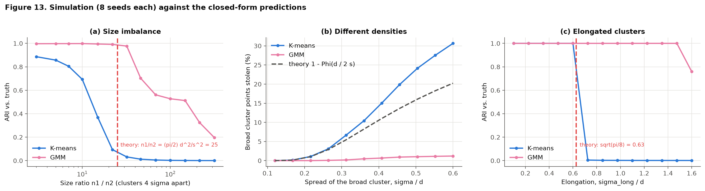

**Evidence.** Figure 12 applies the same data to K-means and to an algorithm whose assumptions fit; Figure 13 checks the formulas by simulation:

| Failure mode | Theory | Simulation (K-means) | GMM / DBSCAN |
|---|---|---|---|
| Size imbalance (4 $\sigma$ apart) | breaks near $n_1/n_2 = 25$ | ARI $<0.5$ from ratio $\approx 13$, $\approx 0.03$ beyond 32 | GMM holds ARI $\ge 0.5$ up to ratio $\approx 150$ |
| Broad cluster, $\sigma_1=0.5\,d$ | loses 16 % (first order) | loses 24 % | GMM loses 1 % |
| Elongation | breaks at $\sigma_a/d=0.63$ | ARI falls through 0.5 at 0.66 | GMM stays at ARI $\approx 1$ |
| Moons / rings | impossible for convex cells | ARI 0.24 / $-0.00$ | DBSCAN ARI 1.00 / 1.00 |

The theory is a first-order guide (centroids drift towards the points they steal, so K-means does slightly worse than predicted in the density case), but both tipping points are located correctly.

**In our data.** The K-means German-language cluster (Section 4.1) and the dishwasher/washing-machine and fridge/freezer clusters are the same phenomenon: clusters whose spread and orientation in LSA space differ from a sphere around a mean.

**Real-world examples.**

- **Land-cover mapping (remote sensing):** water is a tight spectral cluster, but bare soil and urban surfaces form a long, elongated "soil line" in red-NIR space. K-means or ISODATA cuts the soil line into arbitrary pieces; a Gaussian maximum-likelihood classifier with class covariances follows it.
- **Crime or accident hotspots (GIS):** incidents lie along roads and fault lines (non-convex strips), plus scattered isolated events. K-means partitions a road into Voronoi chunks and forces outliers into clusters; DBSCAN follows the strip and labels the isolated events as noise.
- **Customer segmentation:** a few very-high-spend customers against a huge mass of low spend (different size *and* spread): K-means splits the mass and merges the VIPs; a log transform or GMM separates them.

**Remedies.** GMM with full covariance (elliptical, different sizes; use several random starts and pick by likelihood, as K-means initialisation can trap it, see Figure 12 notes), DBSCAN/HDBSCAN (arbitrary shapes, noise), spectral clustering, feature transforms (log, whitening), or over-cluster and then merge.

# 7. Question 2: How does standardisation change the clusters? (experiment)

**Design.** Real systems seldom cluster text alone; they append structured descriptors. To each offer we add four numeric descriptors of its title (`title_chars`, `title_words`, `digit_chars`, `avg_word_len`, whose scales differ by orders of magnitude) to the 20 LSA coordinates. Four conditions, each run through all four algorithms: **A** LSA only (baseline), **B** LSA + descriptors, raw; **C** LSA + descriptors, z-scored; **D** LSA only, z-scored. DBSCAN's `eps` is re-read from the *same point of the k-distance curve* in each space (it equals 0.475, 3.21, 3.01 and 2.34), because `eps` carries the units of the features.

**Mathematics.** Euclidean distance is $d^2(x,y)=\sum_j(x_j-y_j)^2$. Feature $j$ therefore contributes roughly $\mathrm{Var}(x_j)\big/\sum_l\mathrm{Var}(x_l)$ of the geometry. After $z_j=(x_j-\bar x_j)/s_j$ the distance becomes $\sum_j (x_j-y_j)^2/s_j^2$ (a diagonal Mahalanobis distance) and every feature carries the same share, $1/24$ here.

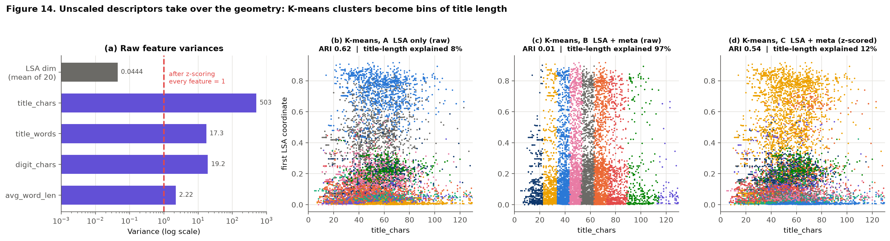

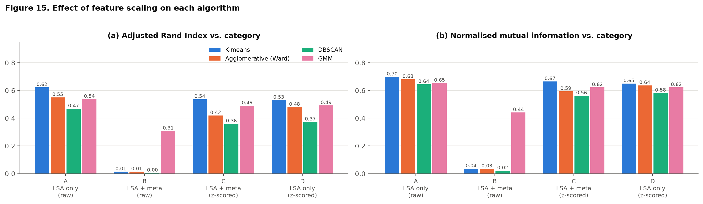

**Results (Figures 14-15; ARI against category).**

| Condition | K-means (mean $\pm$ sd, 10 seeds) | Ward | DBSCAN | GMM |
|---|---|---|---|---|
| A: LSA only | 0.60 $\pm$ 0.04 | 0.55 | 0.47 | 0.54 |
| **B: + descriptors, raw** | **0.01** | **0.01** | **0.005** | 0.31 |
| C: + descriptors, z-scored | 0.54 $\pm$ 0.04 | 0.42 | 0.36 | 0.49 |
| D: LSA only, z-scored | 0.55 $\pm$ 0.06 | 0.48 | 0.37 | 0.49 |

1. **Without scaling the geometry is hijacked.** `title_chars` alone carries 92.7 % of the total variance in B (the 20 LSA coordinates together carry 0.16 %, the four descriptors 99.8 %). K-means and Ward clusters become **bins of title length** (97.5 % and 96.5 % of the variance of `title_chars` is explained by cluster membership, against 8 % in A), and agreement with the categories vanishes (ARI 0.01).
2. **Standardisation repairs it (B $\to$ C):** ARI returns to 0.54 (K-means) and the length effect falls to 12 %. C is still a little below A: the four descriptors are mostly noise for category and now get 1/6 of the weight.
3. **It is not a free lunch (A $\to$ D).** The 20 LSA coordinates already share a scale (std 0.16-0.27); z-scoring them changes K-means by less than its seed-to-seed spread (0.60 $\pm$ 0.04 vs 0.55 $\pm$ 0.06) but lowers Ward (0.55 $\to$ 0.48) and DBSCAN (0.47 $\to$ 0.37), because it inflates weak components. When features share a unit and variance carries information (TF-IDF/LSA, spectral bands), scaling can *remove* signal.
4. **Algorithms differ in scale sensitivity.** K-means, Ward and DBSCAN use raw Euclidean distance, so they are fully exposed. GMM with full covariance models each feature's scale itself (its Mahalanobis distance is affine-invariant), so it degrades less (0.54 $\to$ 0.31), but not to zero because EM starts from a K-means partition computed on the unscaled data.

**Rules of thumb.** Standardise (or robust-scale / log-transform skewed features) when features differ in units or range and each should matter comparably, e.g. *age (years) vs income (dollars)* in customer segmentation, or *NDVI in [-1, 1] vs a 16-bit digital number* in remote sensing. Do not blindly standardise features that already live on a common scale. Always re-derive scale-bound parameters (`eps`) after scaling.

# 8. Question 3: How should DBSCAN's eps and min_samples be selected without arbitrary choices?

> **Short answer.** Treat the pair as **one density threshold plus one resolution**, constrain `min_samples` with the dimension rule, bound `eps` with the k-distance knee, and let a **label-free validity score** pick the cell on a grid, with a guard against chaining.

**Mathematics.** In a region of local density $\lambda$ (points per unit volume in $D$ dimensions) the expected neighbour count inside radius $\varepsilon$ is $\lambda\,V_D\,\varepsilon^{D}$, with $V_D=\pi^{D/2}/\Gamma(D/2+1)$. A point is core when this reaches $m$, so DBSCAN returns the **level set of a density estimate at**
$$\lambda^{*}=\frac{m}{V_D\,\varepsilon^{D}} .$$
The two parameters are not independent: they define one density level $\lambda^*$, and $m$ sets the smallest cluster size that counts as a cluster. Likewise the $m$-th neighbour distance of a point is $r_m(x)\approx\big(m/(\lambda(x)V_D)\big)^{1/D}$, so the sorted **k-distance curve is the distribution of local densities**; its knee is where "cluster-like" densities give way to "sparse" ones. As $\varepsilon$ grows, clusters first form, then **percolate**: bridges of points join them into one component.

**Procedure and result (Section 4.3, Figures 6-7).**

| Step | Rule | Outcome here |
|---|---|---|
| 1. `min_samples` range | $m\ge D+1=21$; default $2D=40$; larger for noisy / duplicated data | scan $m\in\{5,\dots,320\}$ |
| 2. `eps` upper bound | knee of the $m$-distance curve | knee `eps` percolates for $m\ge40$ (**$\ge$ 94 % of points in one cluster**) |
| 3. Choose the cell | maximise $(1-\text{noise})\times\text{silhouette}$, guard: $\ge 2$ clusters, largest $\le 50$ % | **`min_samples` = 160, `eps` = 0.475** (score 0.451) |
| 4. Robustness | plateau, interior optimum, resampling | scores 0.441 / 0.446 / 0.451 for $m$ = 80 / 120 / 160, then 0.348 at 240; mean bootstrap ARI 0.74 |
| 5. Only now, labels | validate | ARI 0.47, the same cell an oracle maximising ARI would have chosen |

**Real-world analogue.** With physical units, choose `eps` from the application: clustering GPS crash points, `eps` = 200 m (a street segment) and `min_samples` = 10 crashes (the smallest hotspot worth acting on). In an abstract embedding there is no such unit, hence the data-driven procedure above. Alternatives that avoid `eps`: HDBSCAN (tried: 92 micro-clusters here) or OPTICS.

**Cautions.** Standardise first (Q2) or `eps` is meaningless; re-derive `eps` after any rescaling; DBSCAN degrades when clusters have very different densities (a single $\lambda^*$ cannot fit all of them), which is exactly where HDBSCAN helps.

# 9. Question 4: Which model for deployment, and what is the evidence?

All numbers come from the executed notebook: generalisation to 25,311 unseen offers, stability under 80 % subsampling (10 refits), scalability up to all 35,311 offers, and the operational properties of each model.

**Table. Generalisation to the 25,311 unseen offers.** Ward and DBSCAN are scored with a nearest-neighbour rule because they have no native `predict()`.

| Model | ARI dev | ARI unseen | NMI dev | NMI unseen | Homog. | Compl. | Noise | Assign 25,311 offers (s) |
| :--- | ---: | ---: | ---: | ---: | ---: | ---: | ---: | ---: |
| K-means | 0.622 | 0.618 | 0.699 | 0.696 | 0.698 | 0.695 | 0.0% | 0.00 |
| Agglomerative (Ward) | 0.550 | 0.560 | 0.681 | 0.686 | 0.676 | 0.697 | 0.0% | 0.27 |
| DBSCAN | 0.469 | 0.476 | 0.644 | 0.647 | 0.682 | 0.616 | 19.3% | 0.15 |
| GMM | 0.538 | 0.533 | 0.654 | 0.650 | 0.650 | 0.651 | 0.0% | 0.07 |

**Table. Stability: ARI between refits on 80 % subsamples and the reference partition (10 refits).**

| Model | Mean ARI | Std | Min |
| :--- | ---: | ---: | ---: |
| K-means | 0.817 | 0.088 | 0.705 |
| Agglomerative (Ward) | 0.676 | 0.036 | 0.632 |
| DBSCAN | 0.736 | 0.027 | 0.695 |
| GMM | 0.692 | 0.038 | 0.643 |

**Table. Fit time in seconds against the number of offers.** Exact Ward would need about 5 GB for the distance matrix at 35,311 offers.

| Offers (n) | K-means | Agglomerative (Ward) | DBSCAN | GMM |
| ---: | ---: | ---: | ---: | ---: |
| 2,500 | 0.09 | 0.24 | 0.03 | 0.37 |
| 5,000 | 0.11 | 1.08 | 0.08 | 0.97 |
| 10,000 | 0.20 | 4.53 | 0.26 | 2.62 |
| 20,000 | 0.28 | 23.26 | 0.62 | 4.08 |
| 35,311 | 0.55 | not run (memory) | 3.95 | 12.92 |

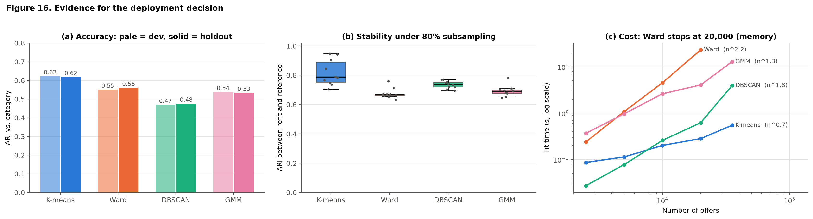

| Evidence | K-means | Ward | DBSCAN | GMM |
|---|---|---|---|---|
| **Accuracy on 25,311 unseen offers** (ARI / NMI) | **0.62 / 0.70** | 0.56 / 0.69 | 0.48 / 0.65 | 0.53 / 0.65 |
| **Generalisation** (dev $\to$ unseen ARI) | 0.62 $\to$ 0.62 | 0.55 $\to$ 0.56 | 0.47 $\to$ 0.48 | 0.54 $\to$ 0.53 |
| **Stability** (mean ARI under 80 % resampling) | **0.82** | 0.68 | 0.74 | 0.69 |
| **Cost** | sub-second, near-linear in $n$ | $\approx n^2$ time, 5 GB of RAM at 35k offers | near-linear to quadratic | seconds to tens of seconds |
| **Scoring new offers** | native, one distance computation per centroid | nearest-neighbour proxy | nearest-core-point proxy, 19 % noise | native with probabilities |
| **What must be chosen** | $k$ | $k$ and linkage | `eps`, `min_samples` (fragile, Q3) | $k$, covariance type, initialisation |

**Why K-means.** It has the best accuracy and stability in the table, it is the cheapest, and it is the only model that is both accurate *and* simple to serve: the whole model is ten centroids. Its weaknesses (Q1) are real but did not bite on this data once the offers were mapped to the unit sphere, where category groups are roughly spherical caps.

**Why not the others.** *Ward*: slightly lower accuracy and the lowest stability, with quadratic memory (35k offers already need 5 GB; a catalogue of millions is out of reach) and no `predict()`. *DBSCAN*: leaves about 19 % of offers unlabelled, depends on two fragile parameters and returns 15 groups that do not map to the 10 categories; keep it as an **outlier / near-duplicate detector**, not as the category assigner. *GMM*: the most flexible and the only soft model, but ARI is about 0.08 lower, it is far slower to fit (tens of seconds against under a second), EM depends on initialisation, and its extra flexibility did not pay on unit-sphere LSA features.

**How strong is the evidence?** K-means' own seed-to-seed spread is about 0.04 ARI (10 seeds: 0.54-0.63), so its lead over Ward (+0.06 to +0.07 ARI, +0.02 NMI) is modest and not decisive on accuracy alone; its leads over GMM (+0.08) and DBSCAN (+0.15) are clearer. K-means partitions vary the most across resamples (sd 0.09), yet even its worst refit (0.71) agrees more with the reference than the *average* Ward refit (0.68). The decision therefore rests on accuracy **plus** stability, cost and serving simplicity together.

**Operating it** (prototype in the notebook, which saves the fitted pipeline to `models/kmeans_deployment.joblib` when run; that file is not committed):

1. **Score** a new title with the saved TF-IDF, SVD, normalisation and centroids; report the **confidence margin** $1-d_1/d_2$ (distance to the nearest vs second-nearest centroid). Route low-margin offers (for example $<0.2$) to human review.
2. **Pre-process language:** detect German titles and translate or route them separately (the largest observed error source, Section 4.1).
3. **Monitor drift** weekly: mean distance to centroid, cluster-share shift, and ARI against the previous model on a fixed audit set; **refit monthly** or when drift crosses a threshold.
4. **Revisit the choice if requirements change:** soft memberships needed $\to$ GMM (tied covariance); noise filtering needed $\to$ DBSCAN pre-filter; a small catalogue that needs a hierarchy $\to$ Ward.

**A caution on the evidence.** An ARI of 0.62 is good but not high. When labels exist, a *supervised* classifier is the right tool for assigning categories; clustering earns its place for unlabelled merchants, for discovering structure, and for bootstrapping labels.

# 10. Limitations and Next Steps

- **Text only.** Offers are described by short titles. Language mixing (German vs English) creates clusters unrelated to category; translation, language ID or multilingual embeddings are the first improvements, and images or attributes would help the fridge/freezer boundary.
- **One dataset, one split.** Results come from one stratified 10,000-offer dev sample and one 25,311-offer holdout; differences below about 0.04 ARI (the K-means seed spread) should not be over-read.
- **Label-informed choices.** $k = 10$ and the embedding size use external knowledge (disclosed); every other tuning step is label-free.
- **Fixed embedding.** TF-IDF + LSA is a simple baseline; sentence embeddings may separate categories better and change the ranking.
- **Timings** are from one laptop run and vary by machine; the *scaling exponents* and memory formulas carry the message.

# 11. Reproducibility

| Item | Detail |
|---|---|
| Run | `jupyter nbconvert --to notebook --execute Clustering_Assignment.ipynb` from the assignment folder (about 10 minutes) |
| Input | `pricerunner_aggregate.csv` in the same folder |
| Packages | see `requirements.txt` (Python 3.14, scikit-learn 1.9, pandas 3.1, numpy 2.5, scipy 1.18, matplotlib 3.11, seaborn 0.13) |
| Seeds | every random step uses seed 42 (or an explicit seed list) |
| Colab | Open the notebook in Colab from GitHub; the first code cell downloads `pricerunner_aggregate.csv` from the repository (or asks for an upload); then Runtime > Run all (slower than a 12-thread laptop) |
| Outputs | `images/` (16 figures, committed). Running the notebook also writes `results/` (the CSV/JSON tables quoted above) and `models/kmeans_deployment.joblib`; those two folders are not committed |
